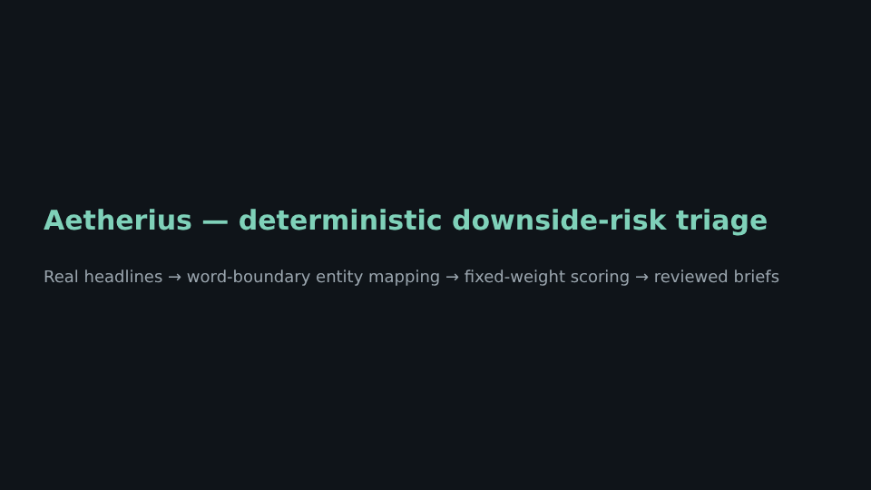

# Aetherius Risk Intelligence

**A deterministic, auditable downside-risk screen over SEC EDGAR filings and GDELT financial news, with a reproducible crisis backtest, an honest timing analysis, and a pre-registered live forward test.**

[](https://github.com/zariffromlatif/Aetherius-Risk-Intelligence/actions/workflows/ci.yml)
[](LICENSE)
[](https://www.python.org/)
[](aetherius/tests/)



---

## In one minute

Aetherius watches a list of companies. It reads new headlines and filings, decides conservatively whether each one really mentions a watched company, scores it with fixed, explainable weights, and puts only evidence-backed, adverse items in front of a human reviewer.

**Headline result.** Replayed on 161 real archived headlines from three crises (SVB 2023, Wirecard 2020, FTX 2022), it flagged **9 of 9** affected names before their formal resolution and raised **0 flags on 3 unrelated control names**.

**The honest qualifier.** In **0 of 9** cases did the first flag come *before* the first headline reporting the stock already falling. The system is fast, auditable **triage** of a market reaction, not a predictor ([working paper §4.5](docs/working_paper/detection_timing_backtest_2026-07.md#45-timing-relative-to-the-market-reaction)).

**What's next.** A [pre-registered live forward test](simulations/forward_test/) started on 2026-10-16. A daily GitHub Action scores live data with the frozen model and commits timestamped results.

## What this project demonstrates

| Area | Where to look |
| --- | --- |
| **Data ingestion** from two public APIs (SEC EDGAR, GDELT DOC 2.0), with retries, rate limits, dedupe keys and idempotent reruns | [`ingestion/`](aetherius/app/services/ingestion/) |
| **Precision-first entity resolution**: word-boundary regex, acronym stoplist, aliases, counterparty links | [`entity_mapping/`](aetherius/app/services/entity_mapping/service.py) |
| **Deterministic scoring**: one shared adverse-language list and formula used by the API, backtest and forward test | [`scoring/`](aetherius/app/services/scoring/service.py) |
| **Backend engineering**: FastAPI, PostgreSQL + Alembic, JWT auth with per-client operator scoping, Celery workers and schedules | [`aetherius/`](aetherius/README.md) |
| **Quality gates before anything reaches a reader**: banned hype language, required disclaimer, evidence for every high-severity item, retry with backoff, dead-lettering | [`delivery/`](aetherius/app/services/delivery/service.py) |
| **Reproducible research**: frozen fixtures, bit-identical metrics, tests that pin the published numbers | [`simulations/backtest/`](simulations/backtest/), [`tests/`](aetherius/tests/) |
| **Research honesty**: confidence intervals, a market-timing check that weakens the headline claim, documented false-positive classes | [working paper](docs/working_paper/detection_timing_backtest_2026-07.md) |
| **Engineering hygiene**: 116 tests, ruff lint and CI on every PR | [`.github/workflows/`](.github/workflows/) |

---

## Results

| Event | Mechanism | Affected names flagged before resolution | Median lead to resolution | Controls flagged | First flag before market reaction |
|---|---|---|---|---|---|
| SVB-2023 | Regional-bank contagion | 5 / 5 | 2.34 days | 0 / 1 | 0 / 5 |
| Wirecard-2020 | Accounting fraud | 1 / 1 | 6.60 days | 0 / 1 | 0 / 1 |
| FTX-2022 | Crypto counterparty contagion | 3 / 3 | 7.12 days | 0 / 1 | 0 / 3 |
| **All** | | **9 / 9** (95% CI 66–100%) | 2.48 days | **0 / 3** (FP rate 95% CI 0–71%) | **0 / 9** |

"Resolution" means the formal event: receivership, insolvency filing or Chapter 11. The "market reaction" is the first headline in the corpus reporting the stock already falling ([`market_reaction_check.py`](simulations/backtest/market_reaction_check.py)).

## Limitations

- **Small sample, chosen with hindsight.** There are three famous failures and nine affected names, and both the events and the adverse-term list were chosen knowing the outcomes. The confidence intervals above are wide.
- **Triage, not anticipation.** Flags arrive together with the press reporting a sell-off.
- **Known false positives.** Tickers that are English words match ordinary text ("coin prices fall" matches `COIN`). Adverse terms match as substrings ("fall" fires inside "shortfall").
- **EDGAR adds provenance, not signal.** Filings are scored on metadata (form and date), never on the filing text.
- **Whitelisted sources only.** Coverage is a fixed list of financial-news domains, which is thin for non-U.S. events.

All of these are written up in [§5 of the working paper](docs/working_paper/detection_timing_backtest_2026-07.md#5-limitations). The forward test is the start of answering them.

---

## How it works

```text
EDGAR filings ─┐
               ├─▶ ingest + dedupe ─▶ entity mapping ─▶ deterministic score ─▶ adverse gate ─▶ signal
GDELT news ────┘   (idempotent)       (word-boundary)    (fixed weights)       (≥1 downside     │
                                                                                term required)  ▼
                                      operator review ◀─ daily brief / urgent alert drafts ◀────┘
                                             │
                                             ▼
                               quality gates ─▶ email + PDF delivery (retry, dead-letter)
```

---

## Quick start

```bash
git clone https://github.com/zariffromlatif/Aetherius-Risk-Intelligence.git
cd Aetherius-Risk-Intelligence
pip install -r requirements.txt

pytest aetherius/tests -q                                          # 116 tests
python simulations/backtest/run_backtest.py --event svb-2023       # or wirecard-2020, ftx-2022
PYTHONPATH=aetherius python simulations/backtest/market_reaction_check.py --markdown
```

Generate a per-company stress-test deck (HTML, print to PDF) from the frozen SVB data:

```bash
python scripts/build_deck.py \
  --ticker SIVB --name "SVB Financial Group" --sector "Regional Banks" \
  --aliases "Silicon Valley Bank,SVB" \
  --thesis "Concentrated regional-bank position with rate-sensitive HTM book." \
  --counterparty "FRC:First Republic Bank:peer:0.6:First Republic" \
  --window 2023-03-06:2023-03-12 \
  --fixture-jsonl simulations/backtest/events/svb-2023/observations.jsonl \
  --out sivb-deck.html
```

To run the full backend (API, worker, scheduler, Postgres, Redis, Mailpit), see [`aetherius/README.md`](aetherius/README.md).

---

## Project structure

```text
aetherius/
  app/
    api/                 # FastAPI routers, JWT auth, per-client scoping
    services/
      ingestion/         # SEC EDGAR and GDELT adapters
      entity_mapping/    # Word-boundary matching, acronym stoplist
      scoring/           # Shared adverse-language list and deterministic formulas
      signals/           # Evidence -> scored, typed risk signal
      pipeline/          # Observation -> evidence -> signal flow (API and workers)
      drafting/ review/  # Brief drafting and operator review workflow
      delivery/          # Quality gates, email/PDF, retries, dead-letter
      reporting/         # Weekly summaries, stress-test deck assembly
    workers/             # Celery beat: hourly ingestion, briefs, retries, retention
  alembic/ migrations/   # Schema
  tests/                 # 116 tests
simulations/
  backtest/              # Frozen crisis fixtures, replay harness, market-timing check
  forward_test/          # Pre-registered live forward test + daily summarizer
docs/
  working_paper/         # Methodology, results and limitations (Revision 2)
site/                    # Static project page (Cloudflare Pages build output directory)
```

---

## Contributing

See [`CONTRIBUTING.md`](CONTRIBUTING.md). PRs must keep scoring deterministic, include tests, and keep the frozen fixtures bit-identical.

## License

Apache License 2.0. See [`LICENSE`](LICENSE).

## Disclaimer

*Research software. It does not provide investment advice, fiduciary services or return forecasts.*
